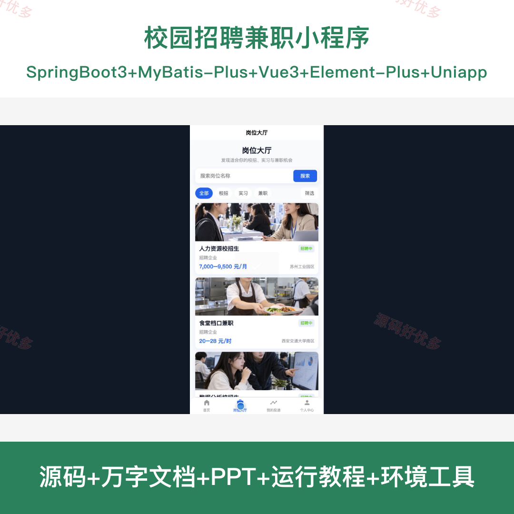
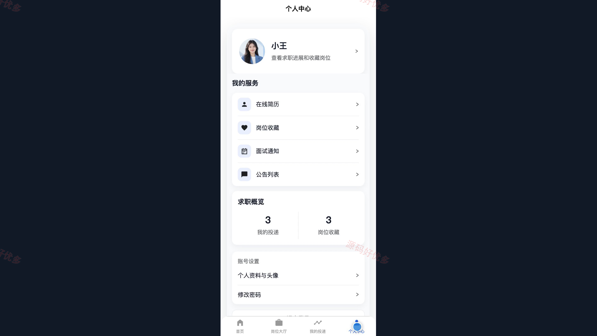
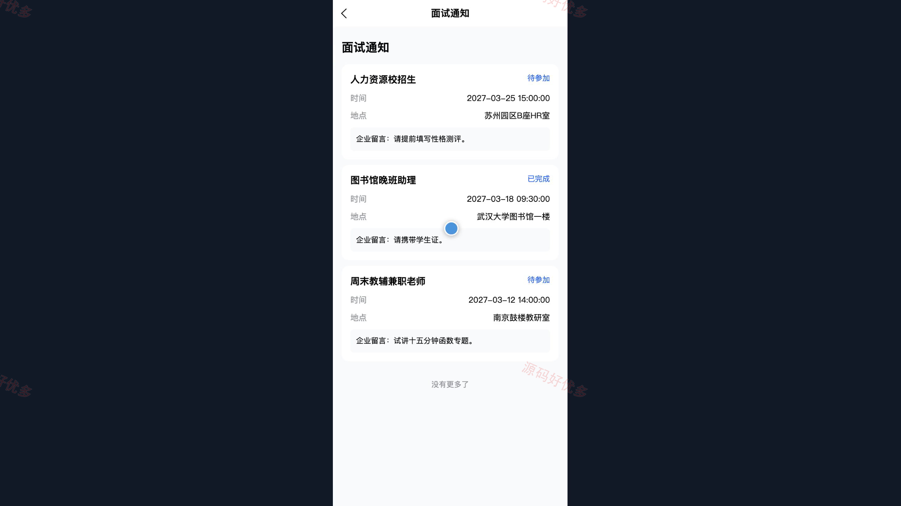
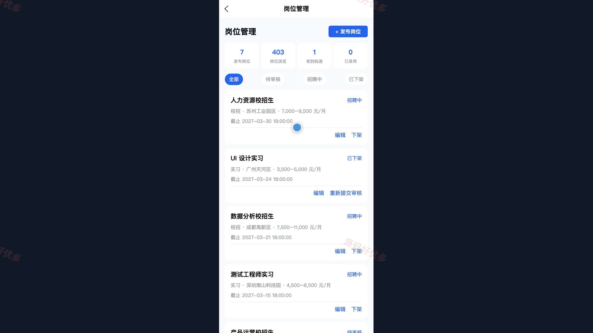
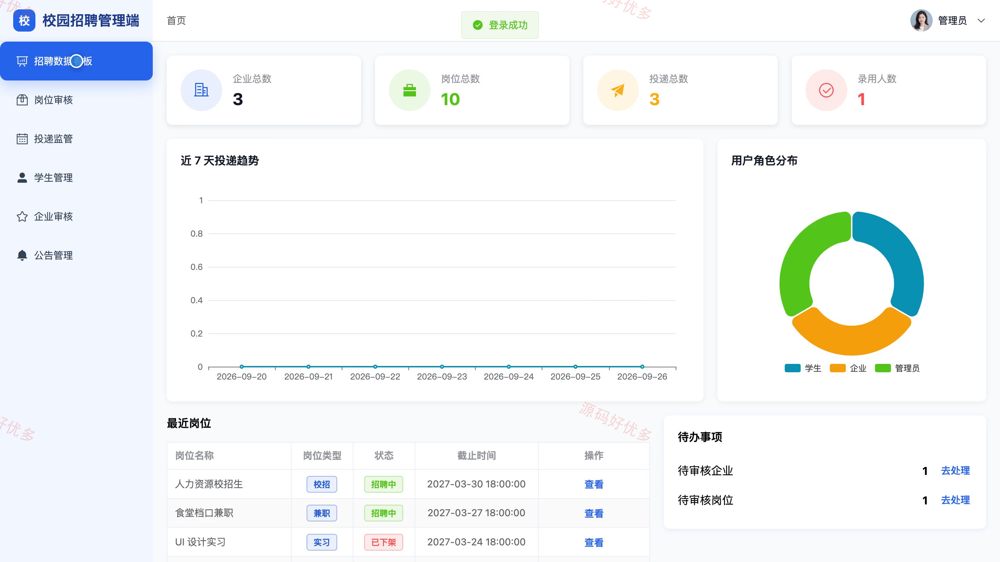
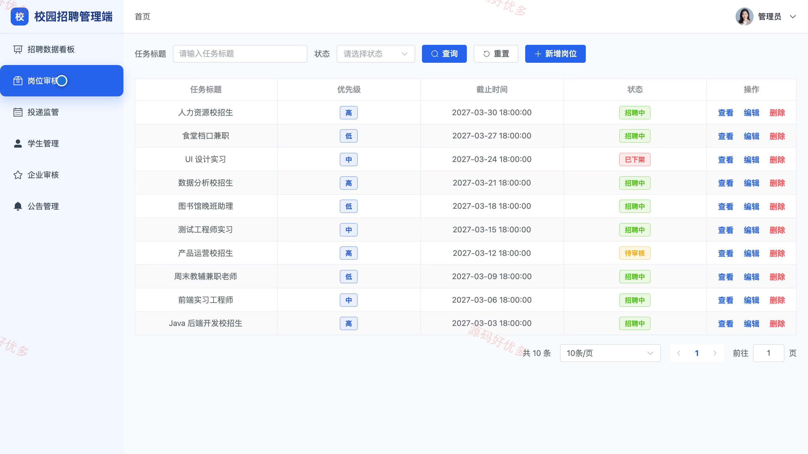
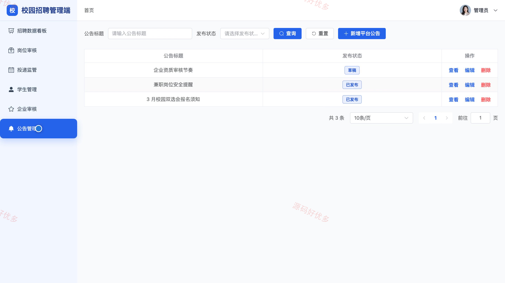

## 源码问题查看主页咨询

### 一、关键词
校园招聘、大学生兼职、实习岗位、校招求职、招聘小程序

### 二、作品包含
源码+数据库+万字设计文档+PPT+全套环境和工具资源+本地部署教程

### 三、项目技术
前端技术： Html、Css、Js、Vue3.4、Element-Plus、uniapp
后端技术：Java、SpringBoot3.2.0、MyBatis-Plus

### 四、运行环境要求
开发工具：IDEA/eclipse + VSCODE + HBuilder X + 微信开发者工具

数据库：MySQL5.7+（共10张表）

数据库管理工具：Navicat10以上版本

环境配置软件： JDK17 + Maven3.6

前端Nodejs：20

浏览器：谷歌浏览器

### 五、项目介绍
项目编号：bs125B

校园招聘兼职小程序由学生和企业招聘人员使用的小程序端、管理员使用的电脑管理端及后端服务组成。学生可查询岗位、维护简历并投递申请；企业可维护资料、发布岗位和处理投递；管理员可审核岗位与企业资料并管理公告。

角色：学生、企业招聘人员、管理员

学生功能：岗位浏览与筛选、岗位收藏、在线简历维护、岗位投递与进度查询、面试通知查看、个人资料与密码管理。

企业招聘人员功能：企业资料维护与认证、招聘岗位发布与管理、简历筛选、投递处理、面试邀请、招聘数据查看。

管理员功能：招聘数据看板、岗位审核、投递监管、学生账号管理、企业审核、公告管理。

### 六、运行截图

